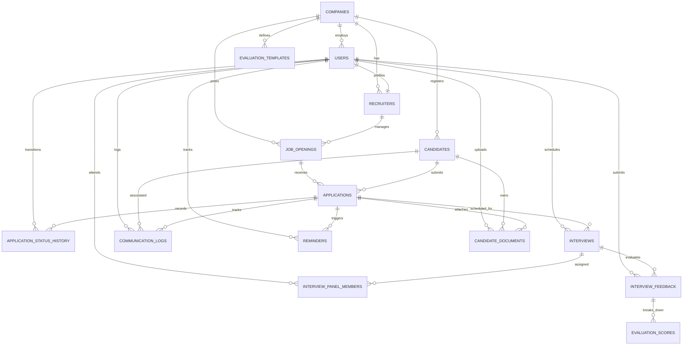

# HireStack PostgreSQL Database Schema & ER Diagram

## 1. Entity-Relationship Diagram

---

## 2. Table Specifications

### 1. `companies`
- Primary tenant table storing enterprise organization profiles.
- Primary Key: `id` (BIGSERIAL).

### 2. `users`
- System user authentication records and roles (`ROLE_HR_ADMIN`, `ROLE_RECRUITER`, `ROLE_INTERVIEWER`).
- Primary Key: `id` (BIGSERIAL).
- Unique: `email`.
- Foreign Key: `company_id` -> `companies(id)`.

### 3. `recruiters`
- Extended profile for recruitment staff.
- Primary Key: `id` (BIGSERIAL).
- Unique: `user_id` -> `users(id)`.

### 4. `job_openings`
- Requisitions with department, salary range, description, and status (`DRAFT`, `OPEN`, `PAUSED`, `CLOSED`).
- Foreign Keys: `company_id` -> `companies(id)`, `recruiter_id` -> `recruiters(id)`.

### 5. `candidates`
- Master candidate talent pool records.
- Unique Constraint: `(company_id, email)` prevents duplicate candidate registrations.

### 6. `applications`
- Link between candidate and job opening with recruitment stage (`APPLIED`, `SCREENING`, `INTERVIEW`, `OFFER`, `HIRED`, `REJECTED`).
- Unique Constraint: `(job_id, candidate_id)` prevents duplicate applications for the same opening.

### 7. `application_status_history`
- Comprehensive audit trail recording every pipeline movement, user responsible, reason, and timestamp.

### 8. `interviews`
- Evaluation rounds (`SCREENING`, `FIRST_ROUND`, `TECHNICAL`, `MANAGERIAL`, `HR_ROUND`, `FINAL_ROUND`).
- Check Constraint: `scheduled_end_time > scheduled_start_time`.

### 9. `interview_panel_members`
- Junction table linking interviews with interviewer user profiles.
- Unique Constraint: `(interview_id, user_id)`.

### 10. `interview_feedback`
- Evaluator ratings (1-5 across technical, problem solving, communication, and culture) and recommendations (`STRONG_HIRE`, `HIRE`, `NEUTRAL`, `DO_NOT_HIRE`, `STRONG_DO_NOT_HIRE`).
- Unique Constraint: `(interview_id, interviewer_id)`.

### 11. `evaluation_templates`
- Standardized rubrics per department.

### 12. `evaluation_scores`
- Specific criteria breakdown scores linked to feedback.

### 13. `communication_logs`
- Candidate contact records (`EMAIL`, `PHONE_CALL`, `NOTE`, `SYSTEM_UPDATE`, `OFFER_LETTER`).

### 14. `reminders`
- Recruiter task reminders with completion toggle status.

### 15. `candidate_documents`
- Resume and portfolio file metadata, local storage path, category, and byte size.

